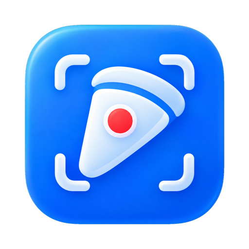
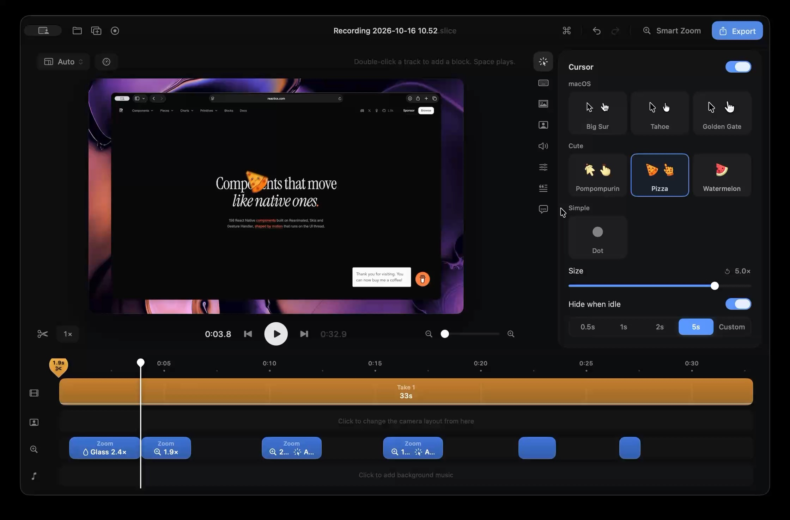

<p align="center">
  
</p>

<h1 align="center">Slice</h1>

<p align="center">
  A native screen recorder and video editor for Mac.<br>
  Free, no account, and everything stays on your Mac.
</p>

<p align="center">
  <a href="https://github.com/rit3zh/slice/releases/latest"></a>
  
  
  <a href="LICENSE"></a>
  <a href="https://buymeacoffee.com/rit3zh"></a>
</p>

<br>

<p align="center">
  
</p>

## Features

- **Recording**: a display, a window or any area, at Retina resolution and up to 120 fps, with camera, microphone and system audio on separate tracks.
- **Zooms**: Smart Zoom suggests zooms from your clicks. Each one can pan or follow the cursor.
- **Liquid Glass lens**: a glass magnifier that glides across the screen and morphs into the next one.
- **Cursor**: resize, smooth, restyle or hide it after recording, and add click effects.
- **iPhone**: record a connected iPhone in its device frame, or edit the take on a 3D iPhone.
- **Transcript**: on-device transcription. Delete words to cut the video, and add subtitles.
- **Voice enhancement**: offline noise removal and podcast-style polish.
- **Export**: 16:9, 9:16 and 1:1 from one edit, up to 4K and 120 fps.
- **Private**: no account, no tracking, no watermark.

## Install

Download `Slice.dmg` from [Releases](https://github.com/rit3zh/slice/releases/latest) and drag Slice to Applications. Requires macOS 15 or later on Apple silicon.

Slice isn't notarized by Apple yet, so the first time you open it macOS says it can't verify the app. To open it anyway:

1. Open Slice once and click **Done**.
2. Go to **System Settings › Privacy & Security**, scroll down and click **Open Anyway** next to Slice.
3. Confirm with your password. After that it opens normally.

Or, in Terminal: `xattr -dr com.apple.quarantine /Applications/Slice.app`

## Build

Requires Xcode 26 and [XcodeGen](https://github.com/yonaskolb/XcodeGen).

```sh
brew install xcodegen
xcodegen generate
open Slice.xcodeproj
```

See [CONTRIBUTING.md](CONTRIBUTING.md) for signing, release builds, the project layout and tests.

## Support

Slice is free and made by one person. If it's useful to you, you can [buy me a coffee](https://buymeacoffee.com/rit3zh). Starring the repo and [reporting bugs](https://github.com/rit3zh/slice/issues) helps too.

## License

Slice is source-available under the [Slice Source-Available License](LICENSE).

You can use it for free, including at work, and read, build and modify the code. Selling it, redistributing it commercially or rebranding it needs written permission. Third-party components keep their own licenses (section 11).

## Credits

[FluidAudio](https://github.com/FluidInference/FluidAudio), [Parakeet](https://huggingface.co/FluidInference/parakeet-ultra-coreml), [DeepFilterNet](https://github.com/Rikorose/DeepFilterNet), [SmoothGradient](https://github.com/raymondjavaxx/SmoothGradient), [border-beam](https://beam.jakubantalik.com), and the [3D iPhone models](Sources/SliceCore/Resources/Models/CREDITS.txt) by their Sketchfab artists.

<br>

<p align="center"><sub>Made by <a href="https://x.com/rit3zh">@rit3zh</a></sub></p>
